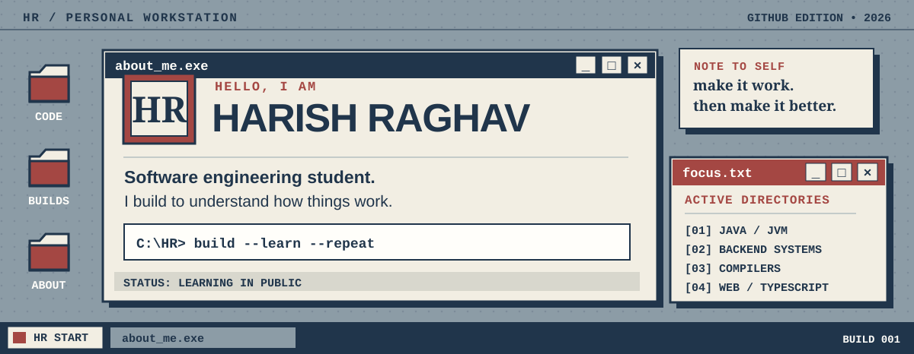
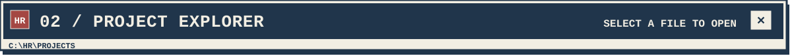
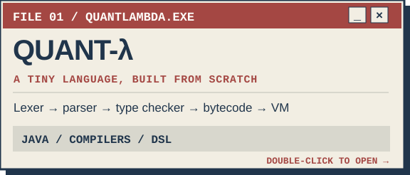
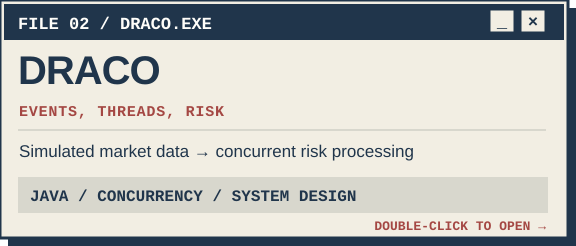
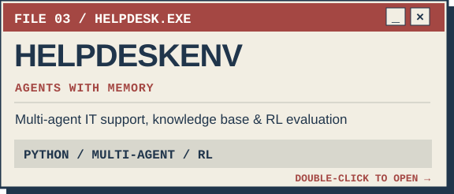
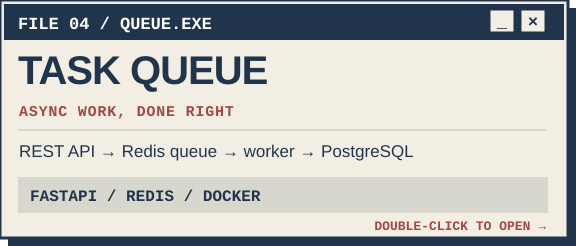
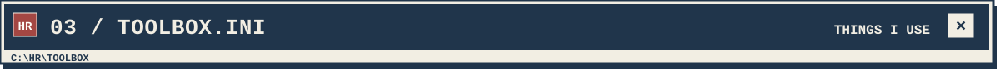

<!--
  HR5206 // PERSONAL WORKSTATION
  Local SVG assets are intentional: no third-party image services or fake stats.
  The visuals are static; actual links are in Markdown below.
-->

<div align="center">
  

  <a href="#about"><b>ABOUT.TXT</b></a> &nbsp;·&nbsp;
  <a href="#projects"><b>PROJECTS</b></a> &nbsp;·&nbsp;
  <a href="#toolbox"><b>TOOLBOX</b></a> &nbsp;·&nbsp;
  <a href="#now"><b>NOW</b></a> &nbsp;·&nbsp;
  <a href="#connect"><b>CONNECT</b></a>
</div>

<a id="about"></a>


I'm **Harish Raghav**, a computer science student who enjoys understanding what's happening below the interface.

I like the kind of projects where I get to ask *why* things work: how a compiler interprets a language, how events move through a backend, and what actually happens when several processes need to share work.

Most of my learning happens by building something, breaking it, reading about the problem, and rebuilding it better.

```text
C:\HR> whoami
name        : Harish Raghav
interests   : backend systems, Java, compilers, AI, the web
approach    : build → test → understand → improve
status      : always learning
```

<a id="projects"></a>


<table>
  <tr>
    <td width="50%">
      <a href="https://github.com/HR5206/QuantLambda">
        
      </a>
    </td>
    <td width="50%">
      <a href="https://github.com/HR5206/DRACO">
        
      </a>
    </td>
  </tr>
  <tr>
    <td width="50%">
      <a href="https://github.com/HR5206/HelpdeskEnv">
        
      </a>
    </td>
    <td width="50%">
      <a href="https://github.com/HR5206/distributed-task-queue">
        
      </a>
    </td>
  </tr>
</table>

**A couple more things from my workspace:**

- **[RepoLens](https://github.com/HR5206/repolens)** — a Next.js / TypeScript web project. [Try the deployed app](https://repolens-sigma-one.vercel.app).
- **[TodoListApp](https://github.com/HR5206/TodoListApp)** — a small ASP.NET Core MVC application using Entity Framework Core and Identity.
- **Workstation-98** — my retro desktop-inspired portfolio, built while learning Next.js, TypeScript, HTML, and CSS.

<a id="toolbox"></a>


| `LANGUAGES` | `BACKEND & DATA` | `TOOLS & WEB` |
| :--- | :--- | :--- |
| Java · Python | FastAPI · PostgreSQL | Git · GitHub |
| TypeScript · JavaScript | MySQL · Redis | Docker · GitHub Actions |
| SQL · C# | REST APIs · SQLAlchemy | Next.js · HTML · CSS |

*Tools I've used in projects, not a claim that I've mastered all of them.*

<a id="now"></a>


```text
[ IN PROGRESS ]  Getting better at DSA and problem solving
[ EXPLORING   ]  System design, AWS, and reliable backend systems
[ BUILDING    ]  Software that teaches me something new
```

Outside the code, I enjoy giving projects a distinct visual identity — hence the old-school desktop look here.

<a id="connect"></a>


**Want to talk about a project, exchange ideas, or collaborate?**

[GitHub](https://github.com/HR5206) · [All repositories](https://github.com/HR5206?tab=repositories) · [HelpdeskEnv demo](https://huggingface.co/spaces/Harishraghav-05/helpdesk_env)

<br />


